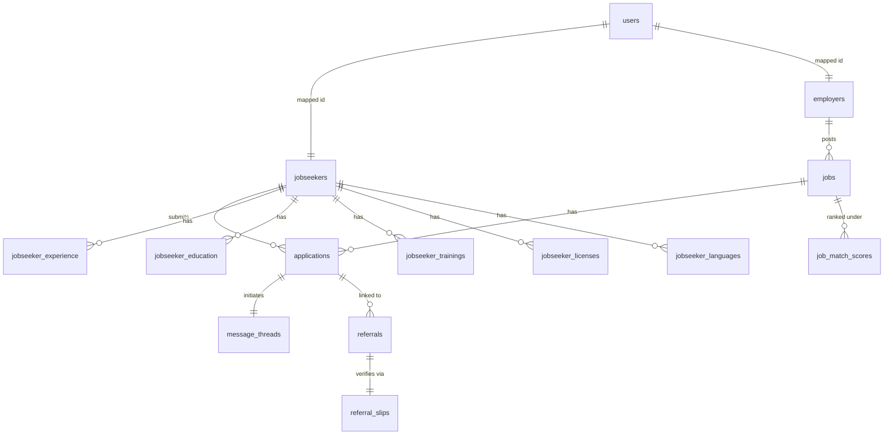
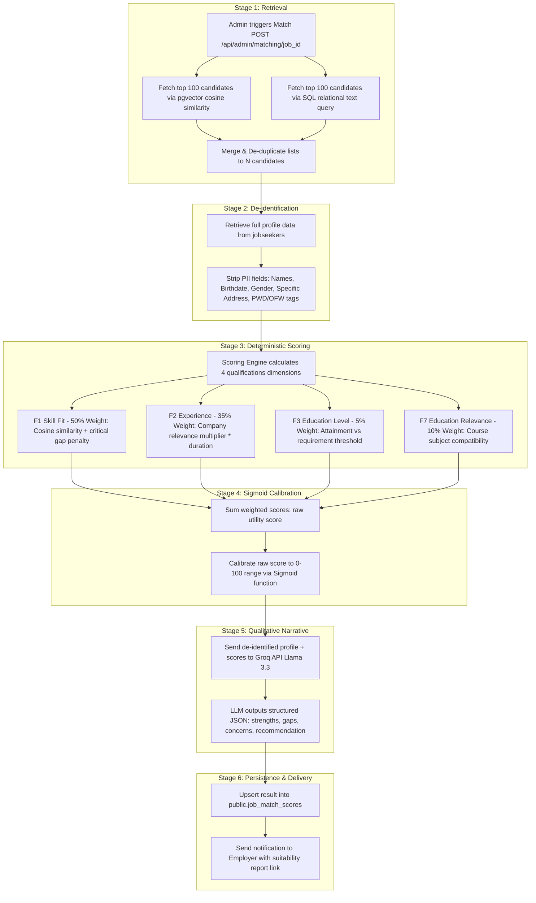
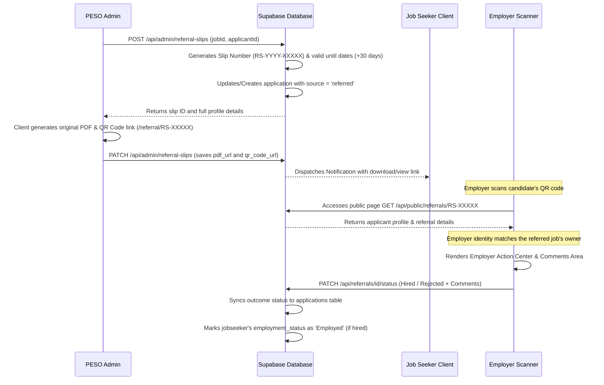

# GensanWorks: System Architecture & Academic Manual

GensanWorks is a digital employment matching, labor market intelligence (LMI), and employment tracking platform customized for General Santos City, Philippines. The system integrates standard workflows of the **Public Employment Service Office (PESO)** with modern algorithmic matching to streamline employment facilitation, promote data transparency, and secure candidate data privacy.

---

## 1. System Overview

### 1.1 Purpose and Objectives
GensanWorks bridges the gap between local labor supply and manpower demand by automating and optimizing:
- **NSRP Compliance**: Incorporates standard National Skills Registration Program (NSRP) Form 1 (Job Seeker) and Form 2 (Employer/Vacancy) requirements.
- **Verification Gatekeeping**: Ensures validation of establishments (SRS Form 2) before allowing them to post active openings.
- **Fair AI Matchmaking**: Employs a de-identified, deterministic, and LLM-assisted hybrid engine to score candidate suitability, eliminating demographic, geographical, and visual biases.
- **Referral Slip Tracking**: Digitizes referral slips with unique serialized reference numbers and QR codes, allowing employers to directly log outcomes (Hired, Rejected, Interview Scheduled).
- **LMI Reporting**: Compiles real-time manpower supply, labor demand, and placement statistics to guide policy decisions.

### 1.2 User Roles and Permissions
The platform defines three core roles, separated by distinct dashboards, layouts, and route guards:

1. **Job Seeker**: 
   - Browses, saves, and applies for verified jobs.
   - Manages a comprehensive NSRP profile (skills, educational history, work experience, licenses, languages).
   - Tracks application status and receives QR-coded referral slips.
   - Communicates with employers via messages.
2. **Employer**:
   - Manages the company's SRS registration status.
   - Posts vacancies (defaults to pending, awaiting admin approval).
   - Views AI matching reports showing suitability-ranked candidates.
   - Manages applicants, updates referral/application statuses, and provides comments through the public verification scan portal.
3. **PESO Admin**:
   - Reviews and approves/rejects employer registrations (SRS Subscriber status).
   - Moderates job postings and publishes them to the job board.
   - Triggers the hybrid AI matching engine for any job vacancy.
   - Generates, serialization-tracks, and issues official referral slips.
   - Reviews audit logs, handles account deletion requests, and views real-time LMI trends.

### 1.3 Tech Stack
- **Frontend Framework**: Next.js (React) using TypeScript and Next.js App Router for server-side rendering (SSR) and routing.
- **Styling**: Vanilla Tailwind CSS and Radix UI components (Shadcn UI primitives) styled to create a glassmorphism and bento-grid theme.
- **Database**: Supabase PostgreSQL database hosting relational tables, triggers, and procedures.
- **Authentication**: Supabase Auth (Cookie-based session persistence and Next.js Middleware route guarding).
- **Real-Time Layer**: Supabase Realtime for instant messaging and notifications.
- **AI Matching Engine**: Groq API (Llama 3.3 70B Versatile) for narrative summaries and skill-gap analysis, with fallbacks to Cloudflare Qwen 2.5 and local Ollama instances.

---

## 2. Platform Modules & Features (By User Role)

### 2.1 Job Seeker Workspace (`/jobseeker/*`)
- **Dashboard (`/jobseeker/dashboard`)**: Displays application states (Pending, Under Review, Interview, Hired), recent job alerts, and quick links to the profile.
- **Job Search & Board (`/jobseeker/jobs`)**: Paginated search for active jobs, filterable by work setup (onsite, remote, hybrid), salary ranges, and educational requirements.
- **Saved Jobs (`/jobseeker/saved-jobs`)**: Personal list of bookmarked postings.
- **NSRP Profile Builder (`/jobseeker/profile`)**: Extensive, tabbed profile builder matching NSRP Form 1 fields:
  - *Personal Data*: PII, demographics, and PWD/OFW/4Ps membership checkboxes.
  - *Education History*: School names, K-12 strands, degrees, and attainment levels.
  - *Experience History*: Past roles, company names, durations, and task lists.
  - *Skills & Licenses*: Technical skills, proficiency levels, professional licenses, and training certifications.
  - *Languages*: Spoken and written languages.
- **Applications (`/jobseeker/applications`)**: Pipeline tracker showing status, expected salary, availability date, interview date, and rejection reason.
- **Messages (`/jobseeker/messages`)**: Real-time communication interface linked to active job applications.
- **Notifications (`/jobseeker/notifications`)**: Actionable system alerts (e.g., "Referral Slip Issued").

### 2.2 Employer Workspace (`/employer/*`)
- **Dashboard (`/employer/dashboard`)**: Aggregates total posts, active openings, total applications, and hiring counts.
- **SRS Registration Profile (`/employer/profile`)**: Business profile including tax IDs, total employees, industry sector code, and uploads for documentation (business permits, BIR 2303, and DOLE certifications).
- **Job Postings (`/employer/jobs`)**: Form to draft and submit postings (NSRP Form 2A details like PSOC code, vacancies, work setup, salary min/max, and required skills).
- **Applicant Review Center (`/employer/jobs/[id]/applications`)**: Lists applicants for a specific post.
- **AI Suitability Report**: Views ranked candidates with suitability scores (Excellent, Strong, Good, Fair, Weak) and qualitative analyses (strengths, gaps, concerns) generated by the AI matching engine.
- **Messaging Portal (`/employer/messages`)**: Real-time chat with applicants.

### 2.3 PESO Admin Workspace (`/admin/*`)
- **Dashboard (`/admin/dashboard`)**: Geographic heatmaps of job distribution, activity feed, and registrations.
- **SRS Moderation (`/admin/employers`)**: Table of registered employers with filters for pending reviews. Admins can view uploaded files and approve/reject profiles (creating history records in `srs_approval_history`).
- **Job Moderation (`/admin/jobs`)**: Review drafts submitted by employers, edit parameters, and publish them to activate the listing.
- **Matching Panel (`/admin/jobs/[id]/match`)**: Initiates vector/SQL retrieval passes, reviews de-identified matching scores, reads LLM narratives, and pushes suitability reports to the respective employer.
- **Referral Slips Center (`/admin/referrals`)**: Table of issued referral slips. Includes a creation interface allowing admins to generate a referral slip for any jobseeker-job combination.
- **LMI Reports (`/admin/reports/lmi`)**: Renders manpower supply segmentation charts, solicited vacancy codes, and referral-to-placement rates.
- **Audit Logs (`/admin/audit-logs`)**: Tracks operations performed by administrators, employers, and jobseekers.
- **Account Deletion Center (`/admin/account-deletion`)**: Safe purging of user profiles following privacy requests.

---

## 3. Database Schema

The database is built on PostgreSQL inside Supabase. The diagram below illustrates the relationship between the core identity, profile, vacancy, transaction, and tracking tables.



### 3.1 Core Identity Tables
#### `auth.users` (Supabase Internal)
- **`id`**: `uuid` (Primary Key)
- **`email`**: `text`
- **`raw_user_meta_data`**: `jsonb` (Holds role, names, and company data)

#### `public.users` (Public Shared Directory)
- **`id`**: `uuid` (Primary Key, references `auth.users`)
- **`name`**: `text`
- **`email`**: `text` (Unique)
- **`role`**: `text` (Values: `'admin'`, `'employer'`, `'jobseeker'`)
- **`employment_status`**: `text` (e.g., `'Unemployed'`, `'Employed'`)
- **`city`**: `text`
- **`province`**: `text`
- **`created_at`**: `timestamptz`

#### `public.admins`
- **`id`**: `uuid` (Primary Key, default: `gen_random_uuid()`)
- **`name`**: `text`
- **`email`**: `text` (Unique)
- **`created_at`**: `timestamptz`

---

### 3.2 Profiles & Sub-Profiles

#### `public.employers`
- **`id`**: `uuid` (Primary Key, references `auth.users`)
- **`email`**: `text` (Unique)
- **`establishment_name`**: `text`
- **`industry`**: `text`
- **`industry_code`**: `text[]`
- **`address`**: `text`
- **`city`**: `text`
- **`province`**: `text`
- **`barangay`**: `text`
- **`account_status`**: `text` (Default: `'pending'`, Check: `account_status IN ('pending', 'approved', 'rejected')`)
- **`srs_status`**: `text` (Default: `'pending'`, Check: `srs_status IN ('pending', 'approved', 'rejected')`)
- **`business_permit_file`**: `text` (URL)
- **`bir_2303_file`**: `text` (URL)
- **`dole_certification_file`**: `text` (URL)
- **`created_at`**: `timestamptz`

#### `public.jobseekers`
- **`id`**: `uuid` (Primary Key, references `auth.users`)
- **`email`**: `text` (Unique)
- **`first_name`**: `text`
- **`last_name`**: `text`
- **`middle_name`**: `text`
- **`birth_date`**: `date`
- **`gender`**: `text`
- **`civil_status`**: `text`
- **`nsrp_id`**: `text` (Unique)
- **`is_pwd`**: `boolean`
- **`is_ofw`**: `boolean`
- **`is_four_ps`**: `boolean`
- **`job_seeking_status`**: `text` (Default: `'not_looking'`, Check: `job_seeking_status IN ('actively_looking', 'open', 'not_looking')`)
- **`profile_complete`**: `boolean` (Default: `false`)
- **`profile_completeness`**: `integer` (0-100 percentage)
- **`other_skills`**: `jsonb` (List of structured skills)
- **`other_skills_others`**: `text` (Comma-separated custom skills string)
- **`created_at`**: `timestamptz`

#### `public.jobseeker_experience`
- **`id`**: `uuid` (Primary Key)
- **`jobseeker_id`**: `uuid` (References `jobseekers.id`)
- **`company_name`**: `text`
- **`position`**: `text`
- **`number_of_months`**: `integer`
- **`responsibilities`**: `text`
- **`start_date`**: `date`
- **`end_date`**: `date`

#### `public.jobseeker_education`
- **`id`**: `uuid` (Primary Key)
- **`jobseeker_id`**: `uuid` (References `jobseekers.id`)
- **`level`**: `text` (e.g. `'college graduate'`)
- **`school_name`**: `text`
- **`course`**: `text` (e.g. `'BS Computer Science'`)
- **`secondary_type`**: `text` (Check: `secondary_type IN ('Non-K12', 'K12')`)
- **`senior_high_strand`**: `text`

#### `public.jobseeker_trainings`
- **`id`**: `uuid` (Primary Key)
- **`jobseeker_id`**: `uuid` (References `jobseekers.id`)
- **`skills_acquired`**: `text`
- **`certificates_received`**: `text`

#### `public.jobseeker_licenses`
- **`id`**: `uuid` (Primary Key)
- **`jobseeker_id`**: `uuid` (References `jobseekers.id`)
- **`professional_license`**: `text`

#### `public.jobseeker_languages`
- **`id`**: `uuid` (Primary Key)
- **`jobseeker_id`**: `uuid` (References `jobseekers.id`)
- **`language`**: `text`

---

### 3.3 Job Vacancies & Applications

#### `public.jobs`
- **`id`**: `uuid` (Primary Key)
- **`employer_id`**: `uuid` (References `employers.id`)
- **`position_title`**: `text`
- **`description`**: `text`
- **`minimum_education_required`**: `text`
- **`main_skill_desired`**: `text`
- **`years_of_experience_required`**: `integer`
- **`job_status`**: `text` (Default: `'pending'`, Check: `job_status IN ('pending', 'open', 'closed')`)
- **`vacancies`**: `integer` (Default: 1)
- **`work_setup`**: `text` (Default: `'onsite'`, Check: `work_setup IN ('onsite', 'remote', 'hybrid')`)
- **`psoc_code`**: `text` (Philippine Standard Occupational Classification code)
- **`salary_min`**: `numeric`
- **`salary_max`**: `numeric`
- **`salary_period`**: `text` (Default: `'monthly'`)
- **`is_active`**: `boolean`
- **`archived`**: `boolean`

#### `public.applications`
- **`id`**: `uuid` (Primary Key)
- **`job_id`**: `uuid` (References `jobs.id`)
- **`jobseeker_id`**: `uuid` (References `jobseekers.id`)
- **`employer_id`**: `uuid` (References `employers.id`)
- **`status`**: `text` (Check: `status IN ('pending', 'under_review', 'interview', 'hired', 'rejected', 'withdrawn')`)
- **`source`**: `text` (Check: `source IN ('direct', 'referred')`)
- **`expected_salary`**: `text`
- **`availability_date`**: `date`
- **`nsrp_forwarded`**: `boolean` (Default: `false`)
- **`extra_attachments`**: `jsonb` (URLs to supplementary files)
- **`rejection_reason`**: `text`
- **`interview_date`**: `timestamptz`
- **`submitted_at`**: `timestamptz`

---

### 3.4 Referrals & Slips

#### `public.referral_slips`
- **`id`**: `uuid` (Primary Key)
- **`slip_number`**: `text` (Unique, e.g. `'RS-2026-00142'`)
- **`job_id`**: `uuid` (References `jobs.id`)
- **`applicant_id`**: `uuid` (References `jobseekers.id`)
- **`issued_by`**: `uuid` (References `admins.id` or admin user account)
- **`issued_at`**: `timestamptz`
- **`valid_until`**: `timestamptz` (Default: 30 days from issuance)
- **`pdf_url`**: `text`
- **`qr_code_url`**: `text`
- **`status`**: `text` (Default: `'issued'`, Check: `status IN ('issued', 'hired', 'not_hired')`)
- **`notified_at`**: `timestamptz`
- **`employer_feedback_at`**: `timestamptz`

#### `public.referrals`
- **`id`**: `uuid` (Primary Key)
- **`jobseeker_id`**: `uuid` (References `jobseekers.id`)
- **`employer_id`**: `uuid` (References `employers.id`)
- **`job_id`**: `uuid` (References `jobs.id`)
- **`application_id`**: `uuid` (References `applications.id`)
- **`status`**: `text` (Check: `status IN ('Pending', 'For Interview', 'Hired', 'Rejected', 'Withdrawn')`)
- **`remarks`**: `text` (Employer comments/feedback)
- **`date_referred`**: `timestamptz`

---

### 3.5 Communications, Notifications & Matching Analytics

#### `public.message_threads`
- **`id`**: `uuid` (Primary Key)
- **`application_id`**: `uuid` (References `applications.id`)
- **`jobseeker_id`**: `uuid` (References `jobseekers.id`)
- **`employer_id`**: `uuid` (References `employers.id`)
- **`job_id`**: `uuid` (References `jobs.id`)
- **`last_message_at`**: `timestamptz`
- **`jobseeker_unread`**: `integer`
- **`employer_unread`**: `integer`

#### `public.messages`
- **`id`**: `uuid` (Primary Key)
- **`thread_id`**: `uuid` (References `message_threads.id`)
- **`sender_id`**: `uuid` (References `users.id`)
- **`sender_role`**: `text` (Check: `sender_role IN ('jobseeker', 'employer', 'admin')`)
- **`content`**: `text`
- **`attachment_urls`**: `jsonb`
- **`read_at`**: `timestamptz`

#### `public.notifications`
- **`id`**: `uuid` (Primary Key)
- **`user_id`**: `uuid` (References `users.id`)
- **`role`**: `text`
- **`type`**: `text` (e.g. `'referral_slip'`, `'matching_report'`)
- **`title`**: `text`
- **`message`**: `text`
- **`read`**: `boolean` (Default: `false`)

#### `public.job_match_scores`
- **`id`**: `uuid` (Primary Key)
- **`job_id`**: `uuid` (References `jobs.id`)
- **`jobseeker_id`**: `uuid` (References `jobseekers.id`)
- **`utility_score`**: `numeric` (Raw calculated suitability index)
- **`suitability_score`**: `numeric` (Calibrated suitability score, 0-100)
- **`grade`**: `text` (Values: `'Excellent'`, `'Strong'`, `'Good'`, `'Fair'`, `'Weak'`)
- **`dimension_scores`**: `jsonb` (Holds sub-scores f1, f2, f3, f6, f7)
- **`summary`**: `text` (AI narrative overview)
- **`strengths`**: `jsonb` (Bullet points of strengths)
- **`gaps`**: `jsonb` (Bullet points of concerns)
- **`bias_flags`**: `jsonb` (Audit flags e.g. profile gaps)
- **`computed_at`**: `timestamptz`
- **`sent_to_employer`**: `boolean`
- **`sent_at`**: `timestamptz`

---

## 4. Key System Data Flows

### 4.1 Job Seeker Registration & Sync Flow

1. **User Sign Up**: 
   The candidate inputs their email, password, first name, and last name. The application submits a payload to the backend auth signup endpoint.
2. **Auth Generation**:
   The backend registers the user in Supabase's internal auth engine (`auth.users`), writing role metadata: `role: 'jobseeker'`.
3. **Database Trigger Sync**:
   PostgreSQL executes the `handle_new_user` trigger function `AFTER INSERT` on `auth.users`:
   - It intercepts the user's role metadata.
   - For `'jobseeker'`, it automatically inserts a synced record into `public.jobseekers` (setting the primary key `id` equal to the new auth `uid` and mapping first and last names) and inserts a corresponding record into `public.users`.
4. **Profile Completion**:
   The user completes NSRP tabs. The client makes `PATCH /api/jobseeker/profile` updates, populating nested arrays for experience, education, training, and licenses.
5. **Re-Scoring Trigger**:
   When a jobseeker modifies their seeking status, qualifications, or skills, the PostgreSQL trigger `rescore-on-status-change` fires, executing a Supabase Edge Function to automatically recalibrate and re-score matching vectors.

---

### 4.2 Employer Verification & Gated Vacancy Posting Flow

1. **Employer Signup**:
   The establishment fills out the registry form. The system creates the user in `auth.users` with `role: 'employer'`. The trigger function `handle_new_user` creates records in `public.employers` and `public.users` with `account_status = 'pending'` and `srs_status = 'pending'`.
2. **Document Upload & Audit**:
   The employer uploads their Business Permit, BIR 2303, and DOLE Certifications.
3. **Admin Moderation**:
   The PESO Admin audits the company profile. Using `PATCH /api/admin/employers/[id]/status`, the admin transitions the status to `'approved'`. This operation logs the auditor name and reasons inside the `srs_approval_history` table.
4. **Approved Posting Gate**:
   When the employer submits a job posting (`POST /api/employer/jobs`), the endpoint executes an **Approval Gate check**:
   ```typescript
   if (employerData.account_status !== "approved") {
     return errorResponse(ErrorCode.FORBIDDEN, "Your employer profile must be approved by an administrator before you can post jobs...");
   }
   ```
5. **Job State Lifecycle**:
   If approved, the job is saved with `job_status = 'pending'` (NSRP Moderation state). A notification is dispatched to all administrators.
6. **Publication**:
   The admin evaluates the job details and marks the job status as `'open'`, publishing the post to the public jobseeker boards.

---

### 4.3 Algorithmic Job Matching Flow

This flow maps candidates to job vacancies using a two-stage hybrid pipeline:



#### Deterministic Scoring Details:
- **Sigmoid Calibration**: Prevents raw score shifts from altering candidate rankings. The function shifts scores using:
  $$\text{Calibrated Score} = \frac{1}{1 + e^{-10 \times (\text{rawUtility} - 0.45)}} \times 100$$
- **Skills Deficit (F1)**: Computes a semantic similarity for each required skill, applying a penalty ($\lambda = 0.25$) when critical skills are missing:
  $$\text{F1 Score} = \text{baseSkillWeightedSum} - (0.25 \times \text{normalizedCriticalDeficit})$$

---

### 4.4 Referral Slip Generation, QR Code Verification & Feedback Lifecycle



---

### 4.5 Labor Market Intelligence (LMI) Reporting Flow

1. **Request Statistics**:
   The admin visits the LMI reports tab, triggering `GET /api/admin/reports/lmi?startDate=...&endDate=...`.
2. **Database Queries**:
   The server runs three queries:
   - Fetches registered jobseeker demographics (genders, civil statuses, age groups derived via birth dates, special groups, and employment status).
   - Fetches solicited job postings (accumulating vacancies and grouping by Philippine Standard Industry Classification sectors).
   - Fetches referral slip transactions (counting total referrals and isolating successful hires).
3. **Data Aggregation**:
   - Genders, civil statuses, and employment states are placed in separate counter buckets.
   - Ages are bucketed into Youth (15-24), Prime working age (25-34), Mid-career (35-44), and Senior/Late career (45+).
   - Industry sector codes are matched against standard Philippine industries (e.g., Code `'01'` for Agriculture, `'14'` for Admin Support, etc.).
   - Placement success rate is calculated as:
     $$\text{Success Rate} = \left(\frac{\text{Hired Placements}}{\text{Total Referrals}}\right) \times 100$$
4. **Data Return**:
   The calculated JSON payload is sent to the client to render charts and export files.

---

## 5. Security & Access Control

### 5.1 Authentication and Next.js Middleware Guards
- **Supabase Auth**: Integrates cookie-based user verification.
- **Route Guarding**: Next.js middleware checks all incoming requests. Standardized directories are locked by user roles:
  - Requests starting with `/jobseeker` require a session with `role === 'jobseeker'`.
  - Requests starting with `/employer` require a session with `role === 'employer'`.
  - Requests starting with `/admin` require a session with `role === 'admin'`.

### 5.2 Row Level Security (RLS)
Every table has RLS enabled to secure data at the PostgreSQL layer, preventing horizontal privilege escalation:
- **`applications`**: Jobseekers can insert or select if `auth.uid() = applicant_id`. Employers can select if `auth.uid() = employer_id`.
- **`jobseekers`**: Candidates can view or update if `auth.uid() = id`.
- **`jobseeker_saved_jobs`**: Users can manage only where `auth.uid() = jobseeker_id`.
- **`referral_slips` & `job_match_scores`**: Configured to restrict public queries; write operations require the Supabase admin service key (`supabaseAdmin`).
- **`messages`**: Users can select messages only if `auth.uid() = sender_id` or `auth.uid() = recipient_id`.

### 5.3 PII and Algorithmic Privacy Protection
Before sending candidate data to the external Groq API (narrative model), the system routes profiles through `deidentifyJobseeker`. 
This function strips all direct and indirect identifiers defined in the `BLINDED_FIELDS` array:

```typescript
export const BLINDED_FIELDS = [
  "gender", "religion", "civil_status", "birth_date", "tin", 
  "disability_visual", "disability_speech", "disability_mental", 
  "disability_hearing", "physical_disability", "disability_physical", "disability_others", 
  "is_pwd", "is_ofw", "ofw_country", "is_former_ofw", "former_ofw_country", 
  "is_four_ps", "household_id_no", "first_name", "last_name", 
  "middle_name", "suffix", "email", "phone", "house_number", "barangay"
];
```

Address strings are resolved into a general logistics zone (e.g., General Santos City, South Cotabato) to mask exact residency locations. The LLM only receives de-identified profiles containing skills, work duration history (stripped of specific company titles if needed, showing general categories), educational level, and credentials.

---

## 6. External APIs and Services

1. **Groq API**:
   - **Model**: Configurable via `GROQ_PRIMARY_MODEL` (Default: `openai/gpt-oss-20b`) and `GROQ_FALLBACK_MODEL` (Default: `openai/gpt-oss-120b`), with Temperature: 0.1 and response format locked to `json_object`.
   - **Purpose**: Translates deterministic scores into qualitative summaries, identifies skill gaps, and formats recruitment recommendations.
   - **Key Rotation & Retries**: Rotates through API keys in `GROQ_API_KEYS` if rate limits (429) or failures occur, with immediate model fallback on 404.
   - **External Fallbacks**: Falls back to Cloudflare Tunnel (Qwen 2.5 7B) or a local Ollama instance if all key rotations fail.
2. **Supabase Edge Functions & Email**:
   - Sends transactional registration notifications and reset password links.
   - Runs background rescoring routines when jobseeker profiles are updated.
